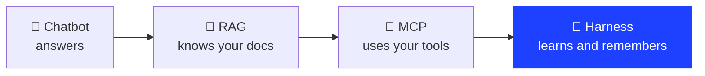
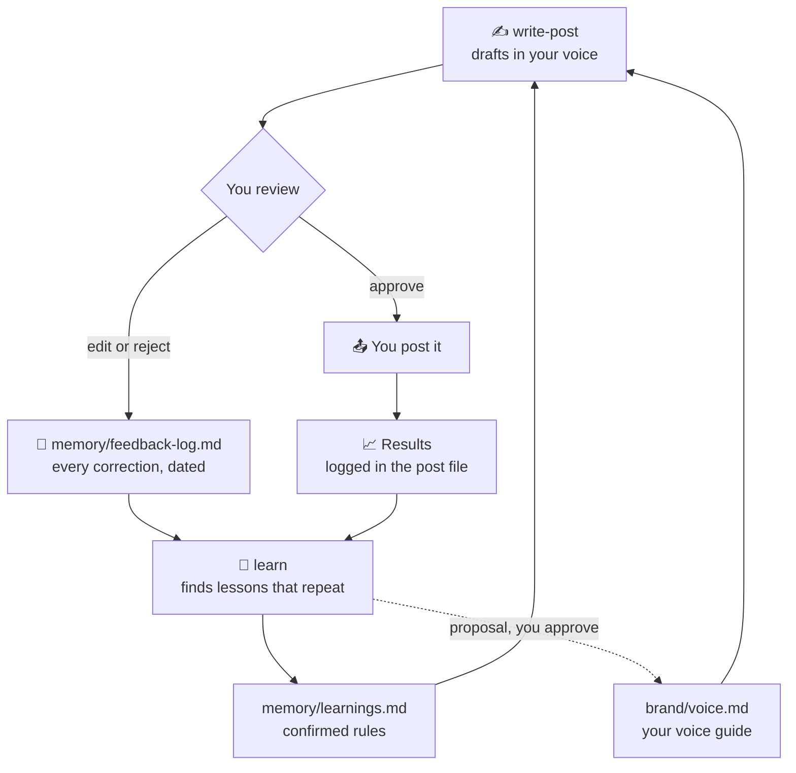

<div align="center">

# 🧠 Marketing Harness

**A Claude setup that writes your posts in your voice, remembers every correction, and gets better every week.**

No code. No subscription. Just a folder you open with Claude.


</div>

---

## Why a harness?

Send a message, it's a chatbot. Give it a document, that's RAG: the model is now grounded.
Give it access to your tools, that's MCP: it can act on your behalf.

**Build a system around it so it curates itself, learns over time and remembers: that's a harness.**



Your agent is good, but not quite to your taste? You don't need a better model. You need a harness around the one
you have. This repo is a small, working one, built for marketing.

---

## What it does

| | |
|---|---|
| 🎙️ **Learns your voice** | A 15-minute interview turns your best posts into a written voice guide |
| ✍️ **Writes your posts** | Three hooks, one draft, a variant per platform (LinkedIn, Instagram, X) |
| 🧪 **Checks every word** | A built-in checker blocks AI tells, em dashes and "translated" French before you see a draft |
| 🔁 **Remembers corrections** | Every edit you make is logged. Twice the same lesson, and it becomes a rule |
| 🛑 **Never posts for you** | You get copy-ready text. You stay the one who presses publish |

---

## The loop

This is the part a chatbot does not have.



One correction is an anecdote. Two is a pattern. The harness only changes your voice guide when you say yes.

---

## Quickstart

### With Claude Code (recommended)

```bash
git clone https://github.com/Ferez22/marketing-harness.git
cd marketing-harness
claude
```

Then type:

```
start
```

Claude reads `CLAUDE.md`, sees that your voice guide is empty and runs the `setup` interview. About 15 minutes later,
it writes your first post.

### With Claude Cowork

1. Run `bash scripts/package-for-cowork.sh`. It creates one ZIP per skill in `dist/`.
2. In Claude, go to **Customize > Skills > + > Upload a skill** and upload the four ZIPs. Code execution must be on.
3. Open this folder in Cowork and say: `run the setup skill, then follow CLAUDE.md`.

> Claude Code loads `CLAUDE.md` and `.claude/skills/` on its own. In Cowork, skills come from your uploads, and
> reading `CLAUDE.md` from the folder is not documented yet, so the key rules are repeated inside each skill.

---

## What's inside

```
marketing-harness/
├── CLAUDE.md                  🧭 the rules: routing, hard rules, memory loop
├── brand/
│   ├── brand.md               facts: offer, audience, proof (never invented)
│   ├── voice.md               how you write (filled by setup)
│   └── ideas.md               content backlog
├── posts/                     one file per post: status, copy, variants, results
├── memory/
│   ├── feedback-log.md        every correction, raw and dated
│   └── learnings.md           confirmed rules, read at every session
├── knowledge/                 your own frameworks and reference tables
└── .claude/skills/
    ├── setup/                 🎙️ onboarding interview
    ├── write-post/            ✍️ hooks, draft, platform variants
    ├── humanize/              🧪 check.py + EN and FR lexicons
    └── learn/                 🔁 turns feedback into rules
```

| Skill | When it runs | What you get |
|---|---|---|
| `setup` | first run, or "setup" | `brand.md` and `voice.md`, validated by you |
| `write-post` | "write a post about...", "what should I post?" | 3 hooks, 1 draft, platform variants, saved in `posts/` |
| `humanize` | before any text reaches you | a clean draft, or a list of what to fix |
| `learn` | "weekly review", or after 5 new corrections | new rules, and voice changes for you to approve |

---

## The checker

`humanize` ships a small script, standard library only. It is the gate every draft has to pass.

```bash
python3 .claude/skills/humanize/check.py draft.txt --lang en
python3 .claude/skills/humanize/check.py brouillon.txt --lang fr --register vous
```

For a draft that says *"In today's fast-paced world, every brand needs content. We help you unlock your full
potential — every single week."*, you get:

```text
[blocking] line 1 AI tell: 'In today's fast-paced world' -> start with the concrete case
[blocking] line 2 fingerprint: 'We help you unlock your full potential — every single week.' -> em/en dash: use a comma, a colon, a full stop, or rewrite
[blocking] line 2 AI tell: 'unlock your full potential' -> say what changes, with a number if you have one

3 blocking, 0 warning(s) | {'sentences': 2}
VERDICT: FIX FIRST
```

| Language | What it catches |
|---|---|
| 🇬🇧 English | AI tells ("delve", "game-changer", "unlock your potential"...), dashes, invisible characters, flat rhythm |
| 🇫🇷 French | AI tics ("Dans un monde en constante évolution"...), English calques ("adresser un problème", "faire du sens"...), French typography, tu/vous mix |

When you keep deleting the same phrase, `learn` adds it to `lexicon/<lang>.json`. The checker grows with you.

---

## Make it yours

- **Your frameworks:** drop hook formulas, sales tables or audience notes in `knowledge/`. Every post reads them.
- **Your platforms:** list them in `brand/brand.md`. `write-post` makes one variant per platform.
- **Your rules:** edit `CLAUDE.md`. It is plain text, and Claude follows it.
- **Another language:** copy `lexicon/en.json`, translate the patterns into tells of your language, add `--lang`.

---

## Want the full studio?

This is the small version of the system I use every day: one brand, posts only.

The full **Content Studio** runs several brands, SEO articles shipped as pull requests from Search Console data,
motion videos rendered in code, brand assets, and a guided onboarding. It comes with lifetime updates and, if you
want, I set it up with you.

👉 **[faresaouani.com](https://faresaouani.com)**

---

## License

MIT. Use it, fork it, sell what you build with it. A link back is always appreciated.

Made by [Fares Aouani Cherif](https://faresaouani.com).
